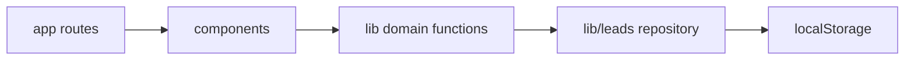

# Architecture Spine — Leads Tracker

## Design Paradigm

Layered client-side application: App Router routes compose components;
components call domain and repository modules; only the repository accesses
browser storage.



## Invariants & Rules

### AD-1 — Static client-only runtime [ADOPTED]

- **Binds:** all routes and FR-001–FR-007
- **Prevents:** incompatible server-dependent features in a static export
- **Rule:** Use Next.js App Router with `output: 'export'`; do not add a server, API route, server action, middleware, database, login, or external service. Browser-created IDs use `/leads/view?id=<id>` and `/leads/edit?id=<id>`, never `[id]` route segments.

### AD-2 — Single versioned persistence owner [ADOPTED]

- **Binds:** FR-001, FR-002, FR-004, FR-006, FR-007
- **Prevents:** components storing incompatible lead and note records
- **Rule:** Store `{ version: 1, leads: Lead[] }` at `leads-tracker:v1`; only `lib/leads.ts` reads or writes `localStorage`, and activities remain embedded in their lead. Missing storage means empty; malformed/unknown-version data is preserved and returned as recoverable. Refresh on `storage` events; last completed full-envelope write wins.

### AD-3 — Canonical lead lifecycle [ADOPTED]

- **Binds:** FR-001–FR-006
- **Prevents:** incompatible stages, timestamps, deletion behaviour, and date calculations
- **Rule:** Use `Stage = New|Contacted|Quoted|Won|Lost`, `Source = Website|Referral|LinkedIn|WhatsApp|Other`, and `Service = Website|Web app|AI agent|Other`. Every mutation validates and sets `updatedAt`; entering Won sets local-date `wonAt`, leaving it clears `wonAt`; deleting a lead deletes its activities. Form `notes` is an editable lead memo, separate from activities. Each activity is `{ id, body, occurredOn, createdAt }`; the repository sets ISO `createdAt` and local-date `occurredOn`, then sorts by timestamp and ID descending.

### AD-4 — Local-calendar dates and shared presentation [ADOPTED]

- **Binds:** FR-002–FR-005 and FR-007
- **Prevents:** UTC-boundary errors and divergent money formats
- **Rule:** Date-only values are local `YYYY-MM-DD` strings; format on-screen AED values exclusively through one `Intl.NumberFormat` helper. CSV uses the fixed header/order in `docs/ARCHITECTURE.md`, raw decimal values, RFC 4180 quoting for commas/quotes/newlines, and apostrophe-prefixes formula-leading text cells.

### AD-5 — Pure domain functions, tested at the seam [ADOPTED]

- **Binds:** all stories
- **Prevents:** different validation, query, aggregation, and export behaviour across views
- **Rule:** Validation, filters/sorts, dashboard aggregation, CSV serialization, dates, and currency formatting live in pure `lib/` functions; unit tests cover those functions and components, and Playwright covers cross-route and responsive flows. Storage access occurs only in browser effects/events, never during module evaluation or static render.

## Consistency Conventions

| Concern | Convention |
| --- | --- |
| Entity and file naming | PascalCase types/components; camelCase fields/functions; one feature component per file. |
| IDs and timestamps | Opaque client-generated string IDs; lead/activity `createdAt` and `updatedAt` are ISO timestamps; date-only values are local `YYYY-MM-DD`. |
| Validation and errors | Return field-keyed messages from shared validation; invalid forms block saving and display inline errors. |
| Responsive UI | Mobile-first CSS; no horizontal scroll at 375px; test 375px and 1280px in Playwright. |

## Stack

| Name | Version |
| --- | --- |
| TypeScript | 5.x |
| Next.js App Router | latest stable selected and lockfile-pinned when STORY-001 initializes the app; static export verified 2026-11-09 |
| Tailwind CSS | latest stable selected and lockfile-pinned when STORY-001 initializes the app; Next.js integration verified 2026-11-09 |
| Jest and React Testing Library | latest compatible stable versions selected and lockfile-pinned when STORY-001 initializes tests; official integration verified 2026-11-09 |
| Playwright | latest stable selected and lockfile-pinned when STORY-001 initializes E2E; official integration verified 2026-11-09 |

## Structural Seed

```text
app/                 route composition
components/          reusable UI
lib/                 types, repository, domain functions
__tests__/           unit and component tests
e2e/                 Playwright journeys
```

Static `out/` is the deployable artifact. It needs any static-file host; no
runtime service or environment secret is required.

## Capability → Architecture Map

| Capability / Area | Lives in | Governed by |
| --- | --- | --- |
| Add and edit leads | `app/leads/*`, `components/LeadForm.tsx`, `lib/leads.ts` | AD-1, AD-2, AD-3, AD-5 |
| Pipeline board | `app/board/page.tsx`, board components | AD-2, AD-4, AD-5 |
| List search/filter/sort | `/`, list/filter components, query helpers | AD-4, AD-5 |
| Detail and activity log | `app/leads/view`, activity components | AD-1, AD-2, AD-3 |
| Dashboard | `app/dashboard`, dashboard helpers | AD-3, AD-4, AD-5 |
| Delete and CSV export | detail/export UI, repository/CSV helpers | AD-2, AD-5 |

## Deferred

- Empty-state wording, first-visit onboarding, and a global default sort direction are product choices; no shared implementation constraint is needed before they are decided.
- A static hosting provider is deferred; any host that serves `out/` is compatible with AD-1 because lead routes use query parameters rather than fallback-dependent dynamic pages.
